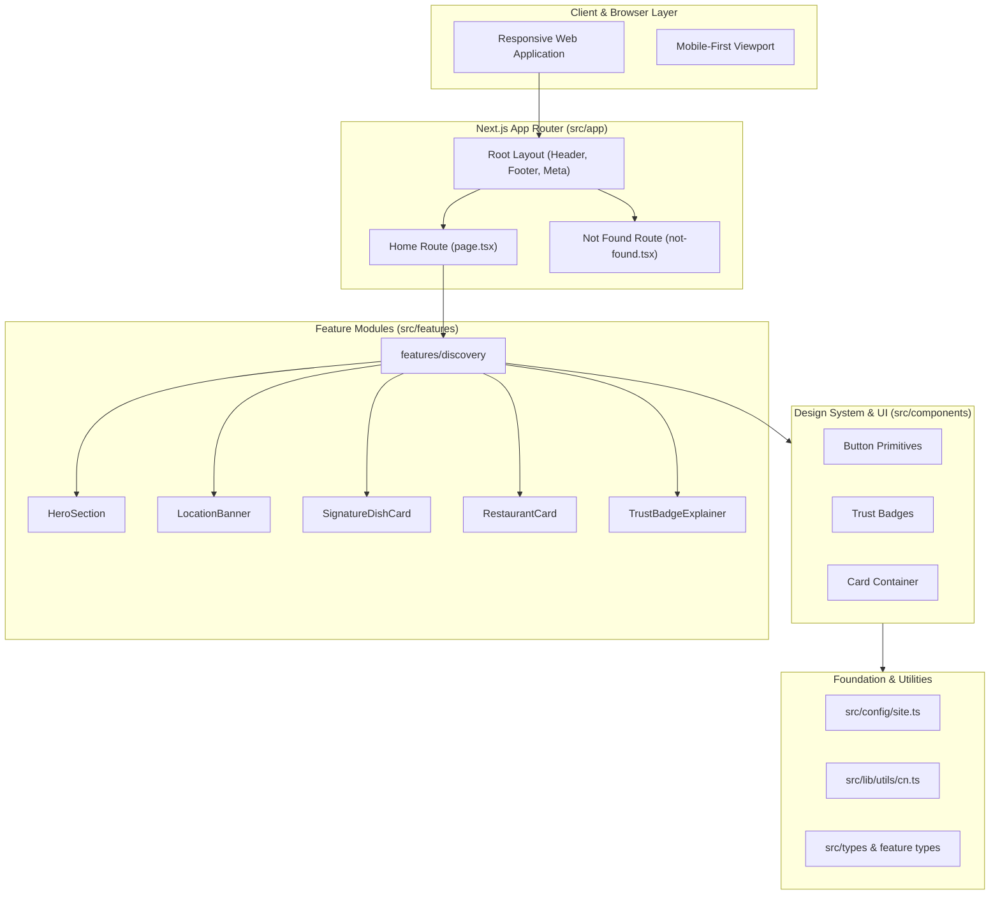

# Project Architecture — Food Discovery Platform

## 1. System Overview

The Food Discovery Platform is an independent, dish-centric culinary discovery application. It addresses the fundamental flaw of mainstream restaurant aggregators: algorithmic bias, paid promotion, and generic star ratings.

Our primary launch location is **Kozhikode (Calicut), Kerala, India**, celebrated globally for its rich Malabar culinary heritage.



---

## 2. Architectural Principles

### 2.1 Server Components First
The application leverages React Server Components (RSC) by default. Data-heavy presentation and static marketing layouts are rendered on the server, minimizing client JavaScript bundles, eliminating hydration waterfalls, and delivering near-instant First Contentful Paint (FCP).

### 2.2 Feature-Sliced Boundaries
Domain logic is structured by feature rather than by generic technical layers:
- `src/features/discovery/`: Owns all discovery components, mock datasets, and domain types.
- Future features (e.g., `src/features/audits/`, `src/features/search/`) will be encapsulated independently with clear public APIs.

### 2.3 Dish-First Data Model
Unlike standard directory apps where restaurants are the primary entity, our domain model treats the **Signature Dish** as a first-class citizen. A restaurant is discovered through its mastery of specific regional dishes (e.g., Dum Biryani, Erachi Pathiri, Kallummakkaya).

---

## 3. Directory Layout & Module Responsibilities

| Directory | Responsibility |
|---|---|
| `src/app/` | Routing, layout shells, metadata, and error handling. |
| `src/components/ui/` | Primitive, accessible, design-token-driven UI components. |
| `src/components/layout/` | Global navigation, headers, footers, and structural wrappers. |
| `src/features/discovery/` | Discovery feed, signature dish showcases, and location positioning. |
| `src/config/` | Application-wide constants, geographic metadata, and site profile. |
| `src/lib/` | Reusable utilities (e.g., class names merger). |
| `src/types/` | Shared TypeScript domain interfaces and value types. |
| `docs/` | Architectural specifications, coding standards, and test strategies. |
| `tests/` | Automated test suites (unit, integration, and e2e). |

---

## 4. Independent Verification Data Flow

```mermaid
sequenceDiagram
    autonumber
    actor User as Food Explorer
    participant UI as Discovery Feed
    participant DishCard as Signature Dish Card
    participant Badge as Trust Badge
    participant AuditData as Verification Record

    User->>UI: Views Kozhikode Discovery Page
    UI->>DishCard: Renders Dish (e.g., Kozhikodan Dum Biryani)
    DishCard->>AuditData: Reads Trust Status & Flavor Profile
    AuditData-->>DishCard: Status: Heritage Landmark / Verified
    DishCard->>Badge: Displays explicit verification tier
    User->>Badge: Inspects verification basis & culinary history
    Note over User,Badge: No paid promotions; 100% transparent audit data
```

---

## 5. Non-Functional Requirements & Performance Goals

- **Performance:** Core Web Vitals targets: LCP < 1.5s, CLS < 0.05, INP < 100ms.
- **Accessibility:** Adherence to WCAG 2.1 AA standards; keyboard navigable, semantic landmarks, high contrast text ratios.
- **Mobile-First Responsiveness:** Optimized for smartphone screens (where 80%+ of local food discovery occurs) up to wide desktop monitors.
- **Security:** Strict Content Security Policies, no client-exposed secrets, sanitize all inputs.
