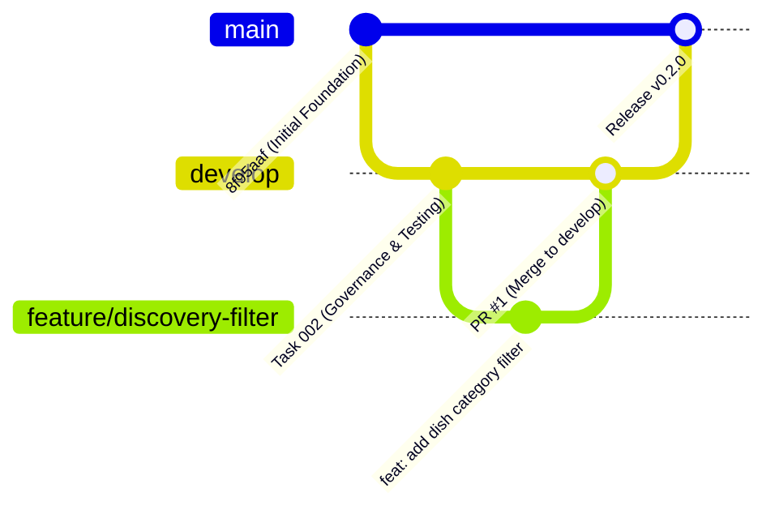

# Git Workflow & Branching Strategy — Food Discovery Platform

This document defines the Git branching model, branch protection rules, review requirements, and repository governance for the Food Discovery Platform.

---

## 1. Branching Model



| Branch Pattern | Role & Lifecycle | Base Branch | Target Merge Branch | Direct Push Allowed? |
|---|---|---|---|---|
| `main` | Production-ready, deployable code only | None | None | ❌ **PROHIBITED** |
| `develop` | Integration branch for verified feature work | `main` | `main` | ❌ **PROHIBITED** (PR only) |
| `feature/*` | Independent agent or developer feature tasks | `develop` | `develop` | ✅ (Agent working branch) |
| `bugfix/*` | Non-critical bug fixes during development | `develop` | `develop` | ✅ (Agent working branch) |
| `hotfix/*` | Urgent fixes addressing production issues | `main` | `main` & `develop` | ✅ (Scoped working branch) |

---

## 2. Remote Repository Configuration

The authoritative remote repository is hosted on GitHub:
```bash
https://github.com/muhammedthanzeel93-cloud/Food-Discovery.git
```

### Checking Configured Remotes
```bash
git remote -v
```
Expected output:
```text
origin  https://github.com/muhammedthanzeel93-cloud/Food-Discovery.git (fetch)
origin  https://github.com/muhammedthanzeel93-cloud/Food-Discovery.git (push)
```

### Initial Push Protocol (Authorized Milestone Only)
When authorized by the project lead to publish:
```bash
# Push main branch
git push -u origin main

# Push develop branch
git push -u origin develop
```

---

## 3. Branch Protection Recommendations for GitHub

To guarantee stability before multi-agent scaling, configure the following protection rules in GitHub Repository Settings:

### 3.1 Rules for `main`
1. **Require a pull request before merging:** Enabled.
2. **Require approvals:** At least 1 human approval.
3. **Require status checks to pass before merging:**
   - `validate` (Typecheck, Lint & Test)
4. **Require linear history:** Enabled.
5. **Do not allow bypassing the above settings:** Enabled.
6. **Block force pushes and branch deletions:** Enabled.

### 3.2 Rules for `develop`
1. **Require a pull request before merging:** Enabled.
2. **Require status checks to pass before merging:** Enabled (`validate` CI job).
3. **Block force pushes:** Enabled.

---

## 4. Development Workflow for AI Agents & Developers

### Step 1: Sync with `develop`
```bash
git checkout develop
git pull origin develop
```

### Step 2: Create a Dedicated Working Branch
```bash
git checkout -b feature/TASK-ID-short-description
# Example: git checkout -b feature/003-dish-filter-pills
```

### Step 3: Implement & Run Mandatory Quality Verification
Before staging commits or opening a PR:
```bash
# 1. Type validation
npm run typecheck

# 2. Linting
npm run lint

# 3. Unit and component test suite
npm run test

# 4. Production build validation
npm run build
```

### Step 4: Commit Using Conventional Commits
```bash
git add .
git commit -m "feat(discovery): add dish category filter buttons"
```

### Step 5: Submit Pull Request Against `develop`
- Open PR targeting `develop` (never `main`).
- Fill out `.github/pull_request_template.md`.
- Await independent human review and passing CI checks.
