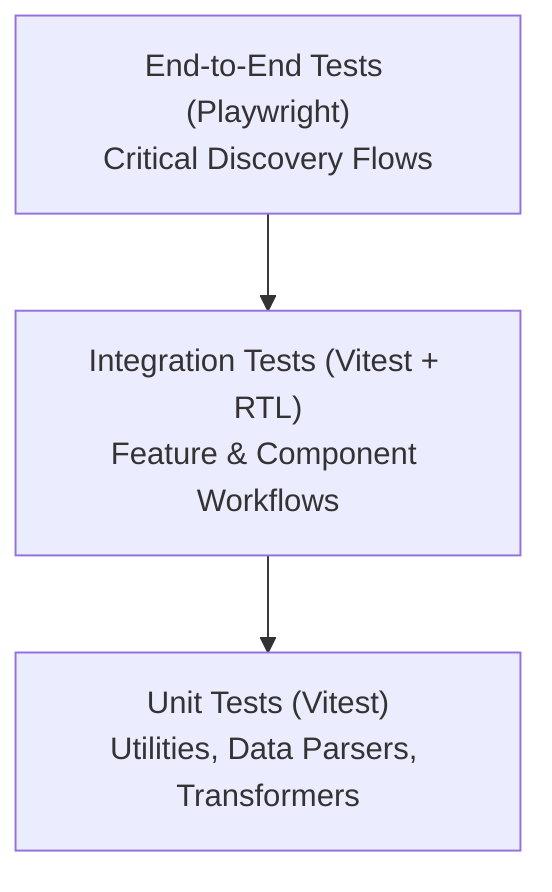

# Testing Strategy — Food Discovery Platform

This document defines the testing pyramid, quality gates, and automated verification plan for the Food Discovery Platform.

---

## 1. Testing Pyramid Overview



| Tier | Focus | Planned Tooling | Execution Frequency |
|---|---|---|---|
| **Unit Tests** | Helper functions, data formatters, calculation utilities | Vitest | Every commit / PR |
| **Component / Integration** | Card rendering, badge displays, filtering logic, accessibility | Vitest + React Testing Library | Every PR |
| **End-to-End (E2E)** | User discovery journey, search flow, navigation integrity | Playwright | Pre-deployment & Nightly |

---

## 2. Quality Gates & Automated Validation

Every pull request or release milestone must pass all three quality gates:

```bash
# Gate 1: Type Safety
npm run typecheck

# Gate 2: Code Style & Linting
npm run lint

# Gate 3: Production Build & Asset Bundling
npm run build
```

---

## 3. Phase 1 Verification Baseline

In Phase 1 (Foundation Baseline), the testing suite is established with:
- Strict TypeScript static analysis (`tsc --noEmit`).
- Next.js and ESLint rule validation.
- Zero-error Next.js production build compiler verification.
- Test structure reserved under `tests/`.

---

## 4. Future Test Scope by Feature

### 4.1 Discovery Module (`src/features/discovery/`)
- Validate that `SignatureDishCard` displays appropriate trust badges according to `trustStatus`.
- Test that vegetarian and non-vegetarian labels match item metadata.
- Ensure sample preview disclaimers are prominently displayed when mock data is in use.

### 4.2 Location Module
- Verify geographic coordinate accuracy for Kozhikode launch landmarks (S.M. Street, Beach Road, CH Flyover).
- Test fallback behavior when location coordinates are missing or undefined.

### 4.3 Accessibility (a11y) Testing
- Automated axe-core audits via Playwright.
- Keyboard navigation (tab sequence and focus indicators) verification.
